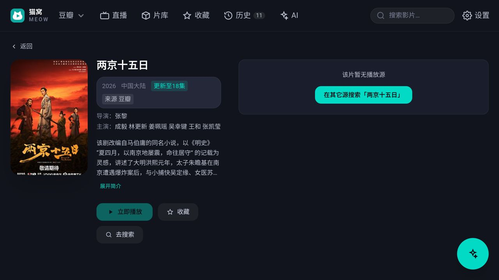
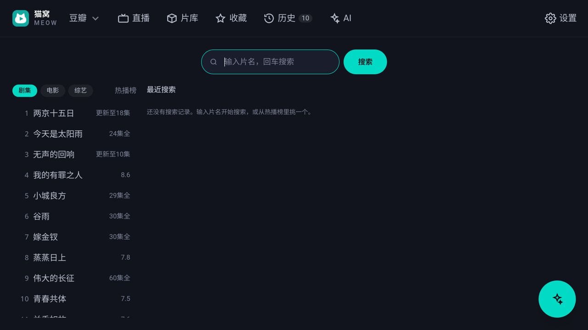
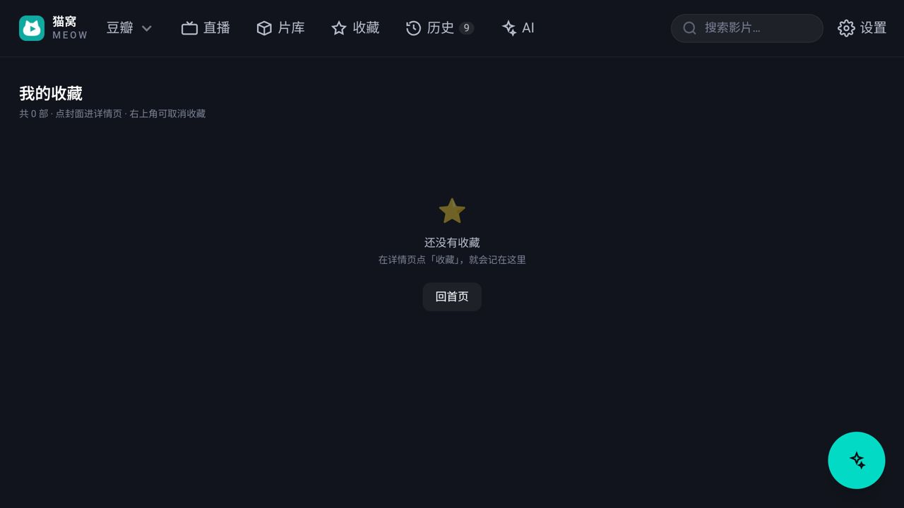
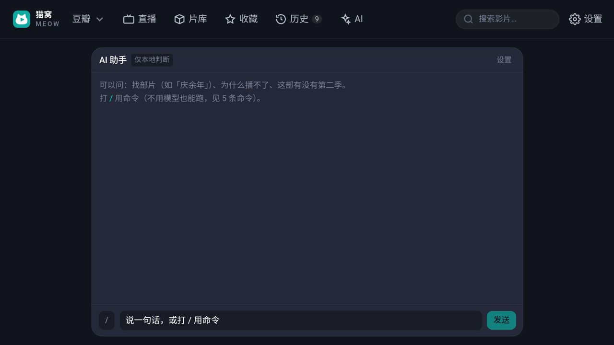

## 猫窝 Meow

猫窝 Meow 是一款开源跨端影视客户端：手机、电脑、电视、NAS 同源同进度，支持点播、直播、弹幕、片库与本地播放。TV 端基于 Android WebView + 端上 JVM 宿主，可直接加载 FongMi / TVBox / 猫窝生态的 spider jar 以及 JS / PY 扩展源，站点配置由用户自行导入。

- 项目主页：https://github.com/upchr/meow
- 文档站：https://upchr.github.io/meow/
- 开源协议：Apache-2.0
- 作者：upchr

## 下载地址

| 平台 | 版本 | 下载 |
| --- | --- | --- |
| Android TV | v1.2.28 | [meow-TV-1.2.28.apk](https://github.com/upchr/meow/releases/download/release-v1.2.28/meow-TV-1.2.28.apk) |

APK SHA256：`1aa9fa97d2aa2e1955d1bab611936aa9ebd6ca8df63e6c2adca1d6a8b3b82f70`

## 来源与安全性说明

- 项目完全开源，源码见 https://github.com/upchr/meow ，任何人均可审计。
- 运行时申请权限仅 `MANAGE_EXTERNAL_STORAGE`（本地片库文件读取）与 AndroidX 自动生成的 `DYNAMIC_RECEIVER_NOT_EXPORTED_PERMISSION`；**不含**通讯录、短信、电话、定位、悬浮窗等敏感权限。
- 应用不内置任何影视内容或站点数据；站点配置、弹幕数据均由用户自行导入，本项目只提供播放与加载能力。
- Release 包由 GitHub Actions 从上述公开源码构建，可下载后比对上方 SHA256。

## 测试截图

以下均为 Android TV 端 APK 实装运行截图（MuMu 模拟器 TV 形态，2560×1440 横屏）：

| 首页 | 详情 | 搜索 |
| --- | --- | --- |
|  |  |  |

| 历史 | 收藏 | 设置 |
| --- | --- | --- |
|  |  |  |

| AI 助手 | 直播播放 |
| --- | --- |
|  |  |

## 测试信息

- 测试时间：2026-11-27
- 测试设备：MuMu Android 模拟器（TV 形态，2560×1440 横屏），直装 APK 实机运行
- 测试版本：v1.2.28（versionCode 1228，minSdk 26 / targetSdk 34，与上方下载包同一构建）
- 测试内容：首页浏览、影片详情、搜索、观看历史、收藏、设置、AI 助手、直播播放（iptv-org 源起播成功）；各页面正常渲染与交互，无崩溃。
